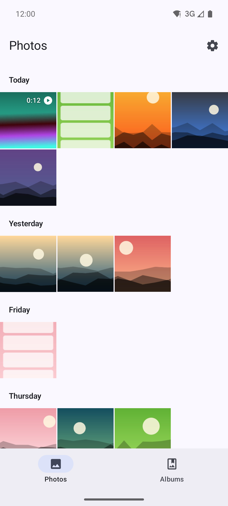
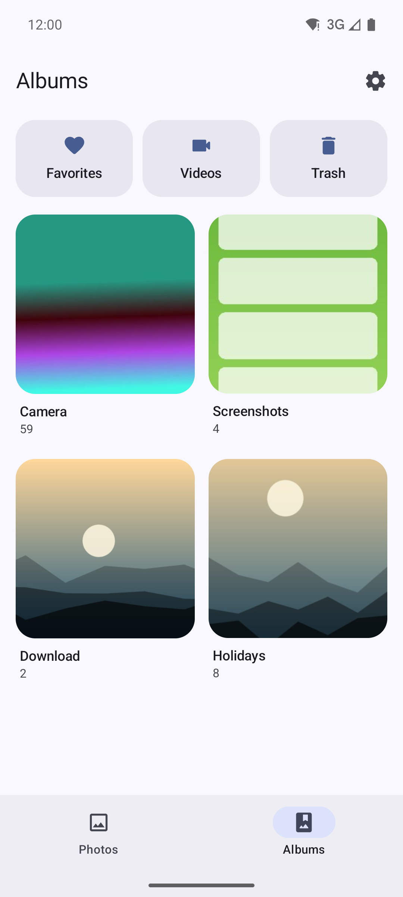
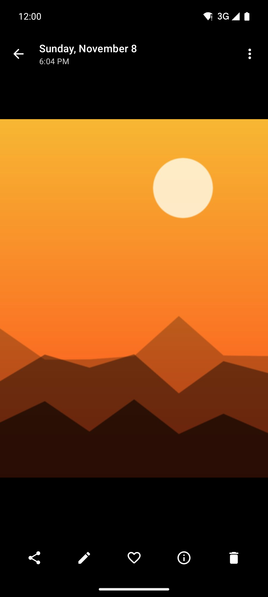
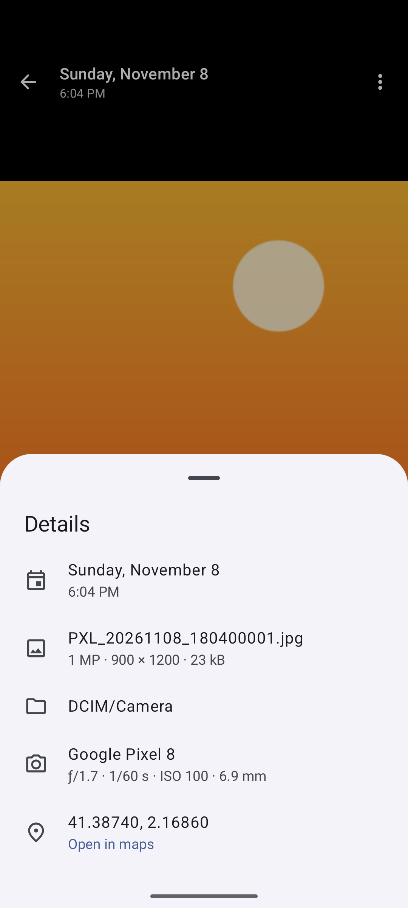

# Gallery

A simple photo and video gallery for Android, built with Kotlin and Jetpack Compose (Material 3 / Material You).

It shows the photos and videos already on your phone, grouped by day, and lets you view, share, favorite and delete them. It has **no internet permission**: your photos never leave the device unless you share them.

<p align="center">
  
  
  
  
</p>

## Features

### Photos
- Every photo and video in one grid, newest first, grouped by day ("Today", "Yesterday", "Friday"…).
- Pinch to change the number of columns; with many columns the grid groups by month.
- Fast scroller with the month you are scrolling through.
- Long-press to select, then drag to select more; tap a day's header to select the whole day.
- Share, favorite or delete several at once.

### Albums
- One album per folder (Camera first), plus Favorites, Videos and Trash.
- Uses Android's own trash and favorites (Android 11+), so other apps see the same thing. Items in the trash are deleted for good after 30 days; until then you can restore them.
- Optional "Skip confirmations" (Android 12+): with the *Media management* permission, trashing and favoriting happen at once, with an Undo button, instead of a system dialog each time.

### Viewer
- Swipe between photos, pinch or double-tap to zoom, swipe down to close.
- Tap to hide the controls and see the photo full screen.
- Videos play inline, with a seek bar.
- Share, edit (with any editor app), favorite, delete, use as wallpaper or contact photo, open with another app.
- Details: date, size, resolution, folder, camera and settings (aperture, exposure, ISO, focal length) and location, with a link to open it in your maps app.

### Works with other apps
- Opens photos and videos from other apps (files, messages, the camera's preview).
- Acts as a photo picker for apps that ask for one, with multiple selection.
- On Android 14, if you only gave access to some photos, it says so and lets you choose more.

### Settings
- Theme: system, light or dark, plus wallpaper (dynamic) colors on Android 12+.
- English and Spanish, with per-app language selection on Android 13+.

## Install

Download the APK from the [latest release](https://github.com/hostyn/gallery/releases/latest) and open it on your phone (Android 8.0 or later). The app asks for access to your photos and videos the first time you open it.

Releases are signed with this certificate. You can check it with [AppVerifier](https://github.com/soupslurpr/AppVerifier) or `apksigner verify --print-certs`:

```
dev.hostyn.gallery
EC:D6:BD:FC:52:58:65:A9:B5:C3:00:A7:60:5F:9F:E3:B6:B7:70:F2:84:50:16:C6:63:8D:06:B8:F0:C5:64:36
```

## Building

Requirements: JDK 17 and the Android SDK.

```bash
./gradlew installDebug         # build and install a debug build on a connected device
./gradlew testDebugUnitTest    # unit tests (date grouping, albums, photo details)
./gradlew assembleRelease      # unsigned release build, minified with R8
```

To make a signed release, run `scripts/release.sh`. It builds the release, signs it with the key in `~/keystores/phone-release.p12` (or the path you pass as the first argument), asking for the password, and writes `dist/gallery-<version>.apk`.

## Tech stack

- Kotlin, Jetpack Compose, Material 3, Navigation Compose
- `MediaStore` for the library, trash and favorites
- [Coil](https://coil-kt.github.io/coil/) for images, with the system's own thumbnails
- [Telephoto](https://github.com/saket/telephoto) for zooming
- [Media3 ExoPlayer](https://developer.android.com/media/media3/exoplayer) for videos
- AndroidX ExifInterface for photo details

## Project structure

```
app/src/main/java/dev/hostyn/gallery/
├── data/        Library (MediaStore), albums, date grouping, thumbnails, photo details, settings
└── ui/
    ├── photos/      Photos grid, album and trash screens
    ├── albums/      Albums list
    ├── viewer/      Photo and video viewer, details sheet
    ├── components/  Grid, cells, date labels, shared bits
    └── settings/    Settings
```

`MainActivity` is the gallery, `ViewActivity` opens photos from other apps and `PickerActivity` lets other apps pick photos.

## License

Copyright (C) 2026 Rubén Martínez Hostyn

This program is free software: you can redistribute it and/or modify it under the terms of the GNU General Public License as published by the Free Software Foundation, either version 3 of the License, or (at your option) any later version. See [LICENSE](LICENSE) for the full text.
